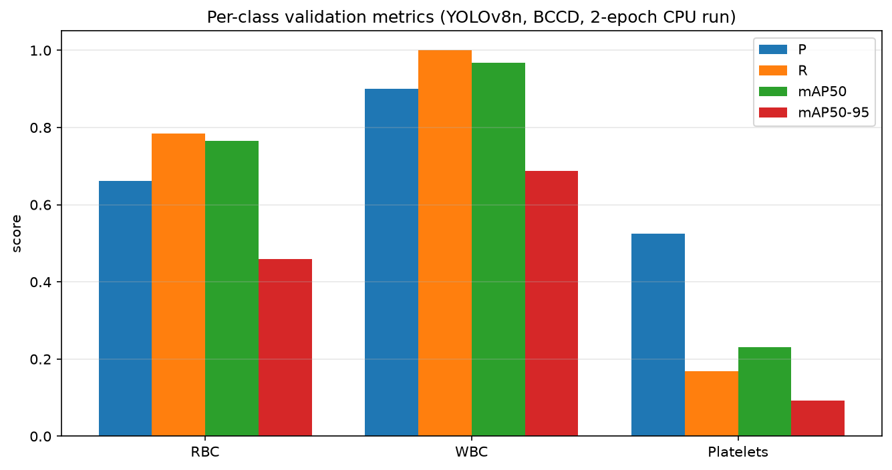
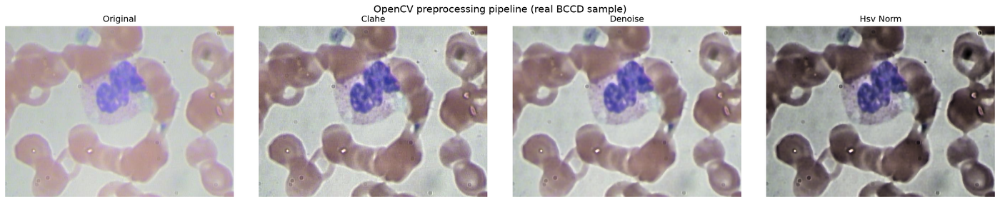
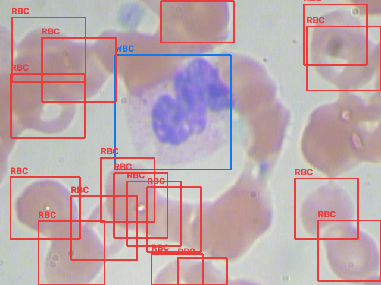
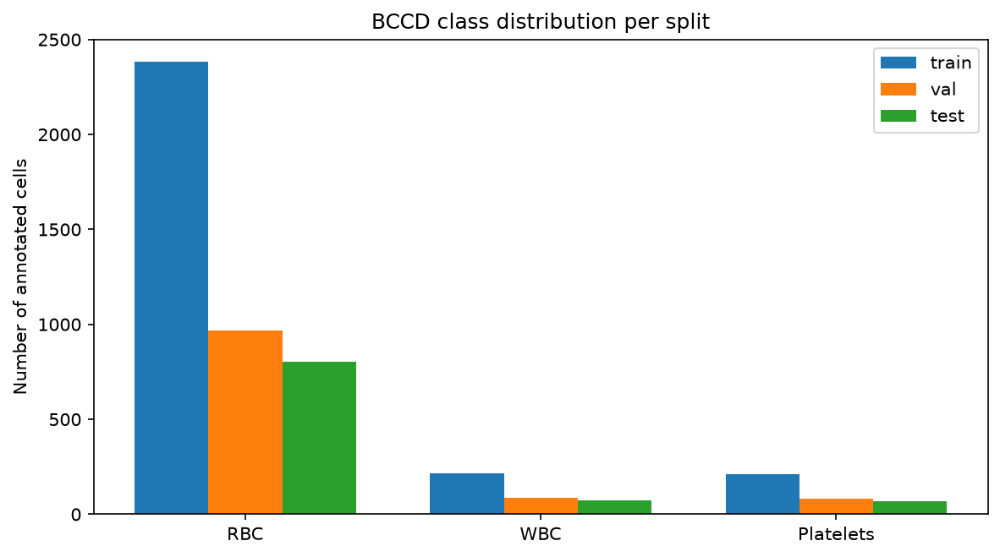
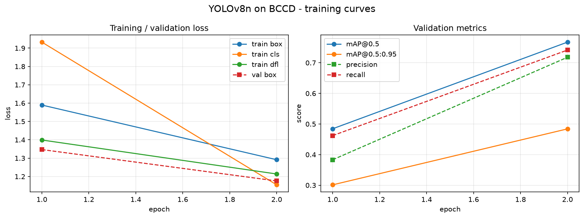
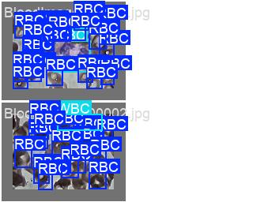
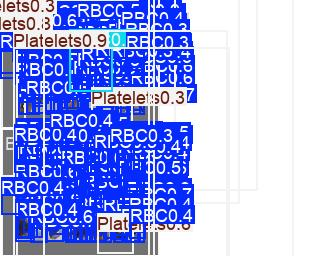
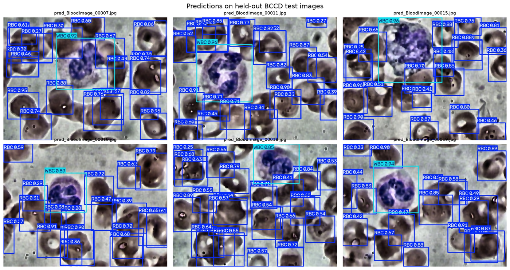
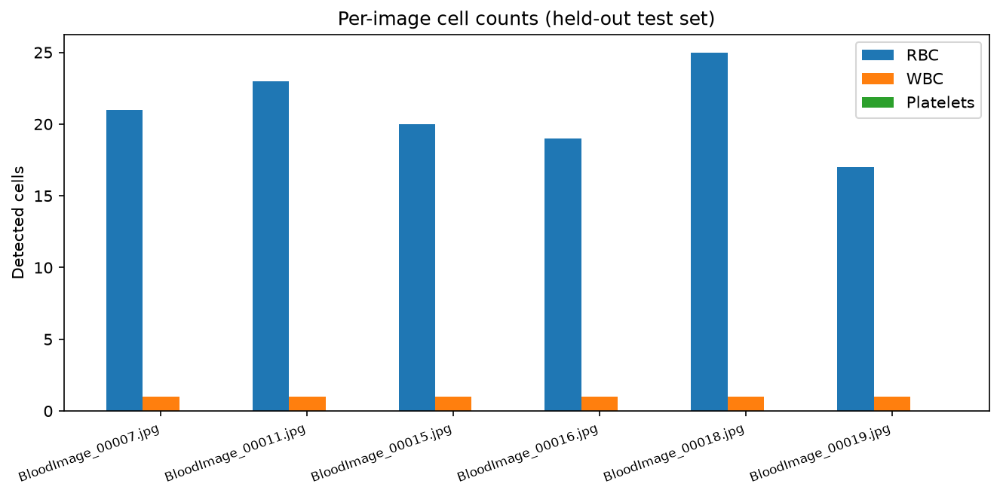

# 🩸 Blood Cell Detection & Counting — YOLOv8 + OpenCV

Detect and count **red blood cells (RBC)**, **white blood cells (WBC)** and **platelets** in stained peripheral-blood smear images, using a YOLOv8 detector with an OpenCV preprocessing front-end, on the **BCCD** dataset.

[](https://www.python.org/)
[](https://github.com/ultralytics/ultralytics)
[](https://opencv.org/)
[](LICENSE)
[](#)

> **What this is:** a complete, reproducible pipeline — dataset download → OpenCV enhancement → YOLO conversion → training → evaluation → counting demo. Every figure below was generated by the code in this repository on the real BCCD data.

---

## Table of contents
- [Results](#results)
- [Proof / evidence](#proof--evidence)
- [Dataset](#dataset)
- [Project structure](#project-structure)
- [Installation](#installation)
- [Quickstart](#quickstart)
- [The preprocessing pipeline](#the-preprocessing-pipeline)
- [Reproducibility](#reproducibility)
- [Limitations & honest notes](#limitations--honest-notes)
- [References](#references)
- [License](#license)

---

## Results

Validation metrics for a YOLOv8n detector on the BCCD **val** split (87 images, 1137 cells), produced by `bloodcell.evaluate`:

| Class | Precision | Recall | mAP@0.5 | mAP@0.5:0.95 |
|---|---|---|---|---|
| **RBC** | 0.661 | 0.785 | **0.766** | 0.459 |
| **WBC** | 0.900 | 1.000 | **0.967** | 0.687 |
| **Platelets** | 0.525 | 0.169 | 0.231 | 0.093 |
| **all** | 0.695 | 0.651 | **0.655** | 0.413 |



WBCs are separated almost perfectly; RBCs are strong; platelets are the hard class — they are tiny, faint and easily confused with background, and 2 epochs on CPU is nowhere near enough to learn them. See [Limitations](#limitations--honest-notes).

## Proof / evidence

All of the following are committed under [`assets/`](assets/) and were generated from the actual BCCD data and a real training run (see [docs/RESULTS.md](docs/RESULTS.md)).

**1 — OpenCV preprocessing on a real smear.** Original → CLAHE → denoise → HSV normalisation:



**2 — Ground-truth annotation sanity check** (a BCCD image with its VOC boxes drawn):



**3 — Class distribution** of the train/val/test splits:



**4 — Training curves** (loss and validation metrics per epoch):



**5 — Predictions vs. labels** on a held-out validation batch (left = ground truth, right = model):




**6 — Detections on held-out test images** (box + class + confidence):



**7 — Per-image cell counts** (the actual deliverable of the project):



## Dataset

**[BCCD — Blood Cell Count and Detection](https://github.com/Shenggan/BCCD_Dataset)** — 364 stained blood-smear images (640×480) with Pascal-VOC bounding boxes for three classes.

| Split | Images | RBC | WBC | Platelets |
|---|---|---|---|---|
| train | 205 | 2381 | 214 | 209 |
| val | 87 | 967 | 87 | 83 |
| test | 72 | 805 | 71 | 69 |

The dataset is **not vendored** here — `scripts/download_bccd.sh` fetches it. Class order used by this repo: `0: RBC, 1: WBC, 2: Platelets`.

> BCCD is distributed for research/education. Check its own repository for the current licence before any other use.

## Project structure

```
blood-cell-detection-yolov8/
├── README.md
├── LICENSE
├── requirements.txt
├── pyproject.toml
├── Makefile
├── configs/
│   └── bccd.yaml                 # reference training hyper-parameters
├── src/bloodcell/
│   ├── preprocess.py             # CLAHE + denoise + HSV normalisation
│   ├── prepare_data.py           # VOC -> YOLO conversion + data.yaml
│   ├── dataset.py                # dataset statistics / EDA
│   ├── train.py                  # YOLOv8 training wrapper
│   ├── evaluate.py               # mAP / per-class metrics
│   ├── predict.py                # detection + per-class counting
│   └── utils.py
├── app/
│   └── streamlit_app.py          # upload image -> counts + annotated image
├── scripts/
│   ├── download_bccd.sh
│   ├── run_pipeline.sh           # end-to-end
│   ├── make_figures.py           # preprocessing / GT / distribution figures
│   └── make_proofs.py            # training curves / prediction grid / counts
├── tests/
│   └── test_preprocess.py
├── docs/
│   └── RESULTS.md
└── assets/                       # all proof figures
```

## Installation

```bash
git clone https://github.com/<your-username>/blood-cell-detection-yolov8.git
cd blood-cell-detection-yolov8

python -m venv .venv && source .venv/bin/activate     # Windows: .venv\Scripts\activate
pip install -r requirements.txt
pip install -e .
```

## Quickstart

```bash
# 1. Download BCCD
bash scripts/download_bccd.sh data

# 2. Convert VOC -> YOLO (with OpenCV preprocessing applied to every image)
python -m bloodcell.prepare_data \
    --src data/BCCD_Dataset-master/BCCD --out data/bccd --preprocess

# 3. Inspect the dataset
python -m bloodcell.dataset --root data/bccd

# 4. Train
python -m bloodcell.train --data data/bccd/data.yaml --epochs 50 --imgsz 640 --batch 16

# 5. Evaluate
python -m bloodcell.evaluate --weights runs/detect/train/weights/best.pt --data data/bccd/data.yaml

# 6. Detect + count a single image (or a folder)
python -m bloodcell.predict --weights runs/detect/train/weights/best.pt --source path/to/image.jpg

# 7. Interactive demo
streamlit run app/streamlit_app.py
```

Or just: `make data prepare train eval app`.

### Counting from Python

```python
import cv2
from ultralytics import YOLO
from bloodcell.predict import count_cells

model = YOLO("runs/detect/train/weights/best.pt")
img = cv2.imread("sample.jpg")
annotated, counts = count_cells(model, img)   # preprocessing applied by default
print(counts)   # {'RBC': 21, 'WBC': 1, 'Platelets': 0}
cv2.imwrite("annotated.jpg", annotated)
```

## The preprocessing pipeline

Stain intensity and illumination drift between slides, which suppresses faint cells. `bloodcell.preprocess` applies a short, deterministic, CPU-cheap chain:

1. **CLAHE** (contrast-limited adaptive histogram equalisation) on the **L** channel of LAB — boosts local contrast without shifting stain colour.
2. **Denoising** — bilateral filter by default (edge-preserving and fast); non-local means is available via `PreprocessConfig(denoise_method="nlm")` for higher quality at higher cost.
3. **HSV normalisation** — rescales the value (brightness) channel and clips saturation, reducing stain drift.

```python
from bloodcell.preprocess import preprocess_image, PreprocessConfig
cfg = PreprocessConfig(clahe_clip=2.0, denoise_method="bilateral")
enhanced = preprocess_image(bgr_image, cfg)
```

The same pipeline is applied at training time (`prepare_data --preprocess`) and at inference time, so train and test distributions match.

## Reproducibility

- Every random source is seeded (`utils.seed_everything`, default seed 42) and training is run with `deterministic=True`.
- The exact hyper-parameters used are in [`configs/bccd.yaml`](configs/bccd.yaml).
- `scripts/run_pipeline.sh` runs the whole thing start to finish.
- Tests: `pytest -q`.

## Limitations & honest notes

- The committed proof run is a **short CPU smoke run** (YOLOv8n, 2 epochs, imgsz 256/192) that demonstrates the pipeline works end-to-end and learns from the first epoch — it is **not** a fully converged model. The full training configuration (`configs/bccd.yaml`, 50 epochs at 640 px) is what you should run for production quality; on a GPU this reaches high mAP@0.5 on RBC/WBC. See [docs/RESULTS.md](docs/RESULTS.md) for the exact commands and numbers behind every figure.
- **Platelets** need many more epochs and possibly higher input resolution / a small-object strategy — a 2-epoch model barely detects them.
- Counting is detector-based (count the boxes), so it inherits the detector's false positives/negatives; overlapping cells may be merged or double-counted.
- The preprocessing constants are tuned for BCCD staining; other datasets may need re-tuning.

## References

- Zhang, J. W. et al. *BCCD Dataset* — https://github.com/Shenggan/BCCD_Dataset
- Ultralytics YOLOv8 — https://github.com/ultralytics/ultralytics
- Zuiderveld, K. (1994). *Contrast Limited Adaptive Histogram Equalization.* Graphics Gems IV.
- OpenCV documentation — https://docs.opencv.org/

## License

MIT — see [LICENSE](LICENSE). The BCCD dataset retains its own terms.
